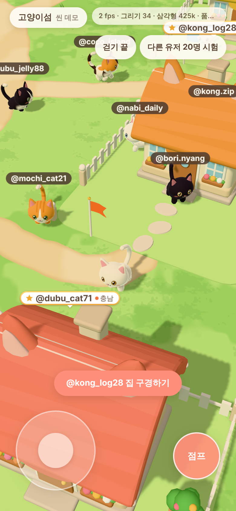
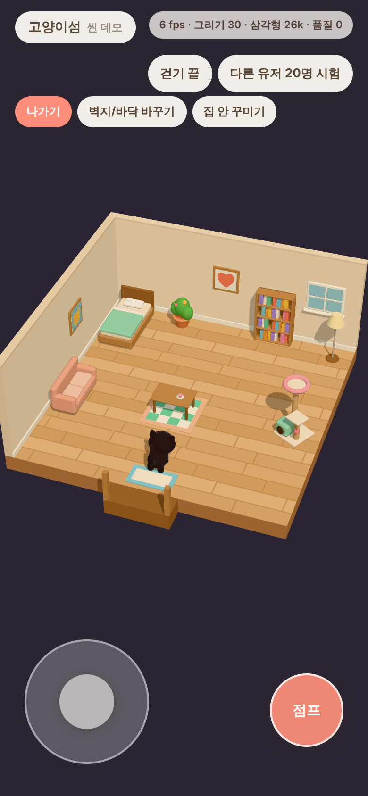

# 고양이섬 3D 씬 (src/scene)

눈에 보이는 부분(섬, 집, 고양이, 깃발, 조명, 카메라, 걷기, 다른 유저의 고양이)을 맡는 폴더예요.
서버, DB, 화면 UI(버튼, 카드, 순위표)는 여기서 만들지 않아요. 씬은 서버를 직접 부르지 않고, 데이터는 항상 함수로 받아요.

## 현재 상태

| 작업 | 상태 |
|------|------|
| 고양이, 집, 꾸미기 아이템 8종, 낮/밤, 지역 깃발, `highlightRegion` | 완료 |
| 작업 1: 동네 단위 배치, 시점 3단계, 동네 단위 지역 색 | 완료 |
| 작업 2: 3인칭 걷기 (`setWalkMode`, `onNearHouse`), 조이스틱, 충돌, 자동 품질, WebGL 복구 | 완료 |
| 작업 3a: 다른 유저 고양이 표시 (`setRemotePlayers`, `onLocalMove`, `getLocalState`), 데모의 "다른 유저 20명 시험" | 완료 (씬 쪽만. 서버와 통신은 앱 쪽 작업 3b) |
| 작업 4: 집 안 들어가기 (`enterHouse`, `exitHouse`, `onDoor`, `onExitHouse`), 자유 배치 (`setYardItemsFree`, `startPlacing`, `stopPlacing`, `rotatePlacing`, `onPlace`, `onPick`), 직접 그린 그림 (`setDrawings`) | 완료 (씬 쪽만. 저장, 그리기 화면, 꾸미기 UI 는 앱 쪽) |
| 다른 유저 낚시 모습(`RemotePlayer.fishing` → 가까운 3명까지 낚싯대/찌), 낚시 시작 때 카메라를 물 쪽으로 (2026-11-15, 사용자 허락으로 Opus 가 함. `tasks/페이블-6-다른유저낚시.md`) | 완료 |
| 작업 5: 지붕 그림 (`setRoofArt`), 주민 고양이 (`setNpcs`, `onNpcTap`), 낚시 모습 (`setFishing`, `fishingSpotAt`), 부두 걷기와 부두 낚시터, 위치 되돌리기 (`setLocalPosition`), 고양이 그림 찍기 (`renderCatPreview`), 고양이 눈 키우기 | 완료 (씬 쪽만. 앱에 붙이는 일은 아래 "앱 쪽에 알릴 것" 0번) |

| 2026-11-15 (Opus): 섬 네 모서리 땅(`CORNERS`), 주민 집 8채(`HOME_SPOTS`, `props.npcHome`, `enterNpcHome`), 바위 언덕 7개(`HILLS`), 동굴 산(`CAVE_HILL`)과 동굴 안 1~3층(`cave/Cave.ts`, `enterCave`, `setCaveNodes`, `exitCave`, `onExitCave`, `caveNodeNear`), 걷기 시야 넓히기(`setWalkZoom`), 아이템 그림 찍기(`renderItemPreview`), 지붕 그림을 지붕 앞면 전체로 키움(`ROOF_ART_SIZE` 3.0, 바탕색 투명 `DrawingStore.roofMaterial`), 꾸미기 중 아이템을 든 채 빈 곳을 짧게 누르면 그 자리로 옮김(`Placer.moveHeldTo`), 탐험가 모자 | 완료 (앱도 붙임) |

| 2026-11-15 (Opus) 소통: 춤(`setDance`, `RemotePlayer.dance`, `cat/dance.ts` 로 높이/방향/크기/제자리 걸음만 움직임), 앉기(`setSitting`), 말풍선 자리(`catScreenPos`), 다른 유저 누르기(`onRemoteTap`), 마을 광장(`TOWN_SQUARE`, `props.townBoard`, `props.stall`, 광장 바닥은 mapField plaza 로 칠함), 이장 옷(`ROLE_PARTS.mayor`), 길 찾기 비용(`walkCost`) | 완료 (앱도 붙임). 춤은 걷거나 점프하면 멈춰 보인다. 말풍선은 앱이 DOM 으로 그린다 |

| 2026-11-16 (Opus): 마당 7.2m(`YARD_HALF` 3.6, 동네 타원 +1.5m), 우편함(`buildYardGeometry`, `mailboxPos`, 충돌), 점프로 낮은 것 넘기(`Walker` `LOW_OBSTACLE`), 고양이 자동차(`car/CatCar.ts`, `setRiding`, `RemotePlayer.car/rideWith`, 내 차/남의 차 뒷자리), 눌러야 놓이는 배치(`Placer.pending`), 꾸미는 동안 조이스틱 멈춤, 집 안 크기 둘(`enterHouse(..., big)`, `ROOM_HALF_BIG` 5.5), 지붕 뒷면 그림(`setRoofArt` 의 `backId`), 그림 캔버스(`easel`), 그림 누르기(`onArtTap`), 지도 회전용 `getViewYaw`, 화가/우체부 옷과 집 간판 | 완료 (앱도 붙임) |

| 2026-11-16 (Opus) 겨울과 마당 넓히기: 기본 마당 6m(`YARD_HALF` 3.0), 넓힌 마당 7.2m(`YARD_HALF_BIG` 3.6, `setBigYards`), 울타리 충돌은 두 크기를 다 두고 그 집 크기만 막음(`Collider.yard`, `skipCollider`), 기본 마당은 길까지 디딤돌 하나 더. 겨울(`setWinter`): 쌓인 눈은 재질이 그림(`glowLambert` 의 `snow` 옵션과 `SNOW.uWinter`, 땅은 `terrain`): 나무(`aSnow`=1)는 늘 꼭대기만, 밤에는 땅/마당/소품 위, 빈 집 지붕(밤만), 물(`aSnow`=-1)은 안 쌓임. LED 전구(`world/winter.ts`, 집 처마와 지붕 옆선, 나무 나선, 구역마다 Points 한 번), 동네 큰 나무와 귤나무에 별과 장식 공, 마을 광장 가운데 큰 전나무(`townTree`, 충돌 반지름 2.1)와 선물 상자, 내리는 눈(`Snowfall`, 카메라 바로 앞은 지우고 품질에 따라 900→360개), 겨울에는 반딧불 끔. 눈사람 가구(`snowman`, 마당 전용은 앱이 막음). 같은 날 다시: 겨울 나무는 모두 눈 모자를 쓴 전나무(`frostedFir`, `BIG_FIR`, `PLAZA_FIR`, `roundFirTiers`, `coneFirTiers`, 겨울/보통 장식 덩어리를 따로 만들어 갈아 끼움, 나무의 재질 눈은 끔 `aSnow`=-1) | 완료 (앱도 붙임) |

**2026-11-15 추가 메모**

- 동굴은 집 안처럼 섬과 따로 떨어진 장면이에요(좌표: 가운데 (0,0), 폭 ±7.2, 깊이 -9.5~7, 앞쪽이 나가는 길). 걷기는 `Walker.room` 으로 막고 바위/광석은 원으로 막아요. 횃불 점광원 3개, 그림자 없음.
- 주민 집 문으로 나오면 `onExitHouse` 를 `-(id+1)` 로 불러요. 앱은 번호와 상관없이 "집에서 나옴"으로만 써요.
- 주민 집/언덕/동굴 산은 장식 덩어리(구역마다 같은 모양, 그리기 수 그대로)에 합쳐져 있어요. 막는 것은 `ZONE_COLLIDERS`.
- 확인: 데모와 앱(세로 390x844, 소프트웨어 그래픽)에서 모서리 모습, 주민 집, 동굴 1층 입구~캐기~안쪽 굴, 지붕 그림, 누른 곳에 놓기. 실제 폰 fps 는 미측정.

**아직 못 한 것**

- **실제 폰에서의 fps 측정.** 작업 환경이 그래픽카드 없는 서버라서 여기서 나오는 fps 는 폰과 관계가 없어요. 아래 "성능"에 대신 잰 값을 적었어요.
- 인스타그램 앱 안의 브라우저에서 직접 열어 본 확인. 터치 조작은 폰 화면 크기를 흉내 낸 브라우저에서만 확인했어요.
- 소리는 없어요(지시대로 이번에는 넣지 않음).
- 다른 유저 표시는 가짜 유저로만 확인했어요. 실제 서버에서 오는 위치로는 아직 못 봤어요(서버는 앱 쪽 작업).
- 작업 4(집 안, 자유 배치, 그림)는 폰 화면 크기를 흉내 낸 브라우저에서 마우스와 가짜 터치로만 확인했어요. 실제 폰에서 손가락으로 끌고 비트는 느낌은 아직 못 봤어요.
- 집 안에 들어가고 나올 때 화면이 부드럽게 넘어가지 않고 바로 바뀌어요(전환 효과 없음).
- 옷에 그림 붙이기는 지시문대로 이번에 하지 않았어요.
- 작업 5 는 씬 데모(가짜 데이터)에서만 확인했어요. 앱에서 실제 서버 데이터로는 아직 못 봤어요. 부두 낚시, 위치 되돌리기, 입양 카드의 3D 고양이는 앱이 새 함수를 불러야 화면에 나와요(앱 쪽 작업).
- 다른 유저 낚싯대는 가까운 3명까지만 그려요(한 명에 그리기 6번). 그보다 먼 낚시꾼은 앉은 모습만 보여요.

**알려진 문제**

- 카메라는 "고양이와 카메라 사이"를 가리는 집/나무만 피해요. 화면 아래쪽에 가까운 나무가 크게 걸리는 것은 그대로 보여요(고양이는 가리지 않음).
- 집 뒤 울타리와 집 사이 같은 좁은 구석으로 계속 밀면 고양이가 구석에 멈춰요. 방향을 바꾸면 빠져나와요.
- 다른 유저 고양이는 받은 위치 그대로 그려요. 씬이 따로 충돌을 계산하지 않아서, 통신이 끊겨 위치가 크게 튄 뒤 미끄러져 따라갈 때는 집이나 나무를 통과해 보일 수 있어요.
- 다른 유저 이름표는 집 이름표처럼 집이나 나무에 가려지지 않고 항상 위에 보여요.
- 걷기 모드에서는 내 고양이 둘레 40 이내 집 26채만 자세히 그려요. 그보다 먼 집은 단순 모델이라 걸어가다 보면 모델이 바뀌는 순간이 멀리서 보일 수 있어요.
- 자유 배치 아이템은 기존 칸 방식 아이템(`setYardItems`)과 겹치는지 보지 않아요. 한 마당에 두 방식을 같이 쓰면 겹쳐 보일 수 있어요.
- 마당 고양이는 자유 배치 가구를 피해 다니지만, 가구를 옮긴 직후에는 화면을 조금 움직이기 전까지 예전 자리를 피해요.
- 침대처럼 긴 가구는 걷기 충돌을 원 여러 개로 흉내 내서, 모서리에서는 살짝 파고들어 보일 수 있어요.
- 지붕 그림은 지역 강조(`highlightRegion`)로 다른 지역 집이 흐려질 때 같이 흐려지지 않아요.
- 주민은 광장 벤치처럼 막힌 곳을 피해 자리를 조금 옮겨 앉아요(앱이 준 자리에서 최대 3 정도). 앱의 "말 걸기" 거리(2.4)는 앱이 준 자리 기준이라 살짝 어긋날 수 있어요.
- 부두 가운데쯤에서 옆으로 낚시하면 찌가 얕은 물가에 떨어져요.
- 새 아이템을 꺼냈는데 놓을 빈 자리가 하나도 없으면 빨간 채로 가운데에 떠 있고 `onPlace` 는 오지 않아요. 빈 곳으로 끌어다 놓으면 그때 알려요.

## 보는 방법

```
npm install
npm run dev
```

`http://localhost:5173/scene-demo.html` 을 열어요. 가짜 집 데이터로 씬을 돌리는 확인용 화면이에요.

- 아래 버튼: 낮/밤, 집 수 바꾸기(100 → 1,000 → 3,000채), 아무 집 가기, 특이한 집, **걷기**, **다른 유저 20명 시험**
- 지역 버튼 줄: `highlightRegion` 확인용 임시 버튼 (전체 = 해제)
- 위쪽: fps, 그리기 횟수, 삼각형 수, 자동 품질 단계

주소 뒤에 값을 붙이면 처음 화면을 바꿀 수 있어요.

| 값 | 뜻 |
|----|----|
| `?n=3000` | 집 수 (100, 1000, 3000 등) |
| `?time=night` | 밤으로 시작 |
| `?region=seoul` | 그 지역 강조 |
| `?house=12` | 12번지가 있는 동네로 이동 |
| `?at=12&dist=24` | 12번지를 거리 24에서 보기 (`dist` 만 쓰면 1구역 가운데) |
| `?walk=12` | 12번지 고양이로 걷기 시작 |
| `?q=0` | 자동 품질을 끄고 단계를 고정 (0=최고, 4=최저) |
| `?bots=28` | 가짜 유저 28명으로 "다른 유저 20명 시험"을 바로 시작 |
| `?warp=1` | 가짜 유저가 가끔 순간이동 (미끄러지듯 따라가는지 확인용. `bots` 와 같이 써요) |
| `?walk=12&inside=12` | 12번지 고양이로 12번지 집 안에서 시작 |
| `?walk=12&inside=12&decor=1` | 집 안 꾸미기 모드까지 켜고 시작 |
| `?yard=12` | 12번지 마당 꾸미기 모드로 시작 (걷기 아님) |
| `?roof=1` | 지붕 그림 붙이기 (사는 집 셋 중 둘) |
| `?npc=1` | 동네 가운데마다 주민 세우기 |
| `?fish=pond` / `?fish=pier` | 연못 / 부두 끝으로 가기. `&fishstep=3` 을 붙이면 낚시 단계를 그만큼 넘김 |
| `?preview=1` | 고양이 그림(`renderCatPreview`) 6장 보기 |

확인용 화면 모음은 `docs/screenshots/` 에 있어요(동네 시점, 전체 시점 1,000채, 밤, 지역 강조, 걷기, 다른 유저, 집 안, 꾸미기 중 겹침 표시, 마당 자유 배치).

## 사용법 (앱 쪽에서)

```ts
import { createIslandScene } from './scene';

const island = createIslandScene(canvas);
island.setHouses(houses);            // 집 전체 (빈 집 포함). 바뀌면 전체 목록을 다시 넘김
island.setYardItems(12, items);      // 12번지 꾸미기
island.setUnlockedZones(2);          // 열린 구역 수
island.setTimeOfDay('night');
island.focusHouse(12);               // 12번지가 있는 동네로 부드럽게 이동
island.highlightHouse(78);           // 오늘의 특이한 집 (금색 테두리 + 별). null 이면 해제
island.highlightRegion('seoul');     // 서울 집만 밝게. null 이면 해제
island.onHouseTap((houseNo) => { /* 팝업 띄우기 */ });

island.setWalkMode(true, myHouseNo); // 걷기 시작 (내 집 대문 앞, 내 집 고양이 모습)
island.onNearHouse((houseNo) => {    // 걷다가 어떤 집 마당 입구에 가까이 가면 번호, 멀어지면 null
  /* "구경하기" 버튼 보이기/숨기기 */
});
island.setWalkMode(false);           // 동네 시점으로 부드럽게 돌아감

island.setRemotePlayers(players);    // 내 주변에 보여줄 다른 유저 목록 전체 (위치가 올 때마다 통째로)
island.onLocalMove((state) => {      // 걷는 동안 내 고양이가 움직이면 { x, z, rotY, anim }
  /* 1초에 8번으로 줄여서 서버로 보내기 */
});
island.getLocalState();              // 내 고양이의 지금 상태 { x, z, rotY, anim }

island.resize();                     // 캔버스 크기가 바뀌면
island.dispose();
```

- 기존 함수의 이름과 인자는 그대로예요. 작업 2에서 `setWalkMode`, `onNearHouse` 가, 작업 3a에서 `setRemotePlayers`, `onLocalMove`, `getLocalState` 가, 작업 4에서 집 안/자유 배치/그림 함수(아래 "집 안, 자유 배치, 직접 그린 그림")가 추가됐어요.
- `houseSlot(houseNo)` 는 `{ x, z, zone, neighborhood, rot }` 을 돌려줘요(`src/scene/layout.ts`, `src/scene` 에서도 다시 내보내요).
  - `zone` 은 0부터 세요(1~100번지가 zone 0).
  - `neighborhood` 는 섬 전체에서 이어서 세는 동네 번호예요(0부터. 1~10번지가 0, 11~20번지가 1, 101~110번지가 10).
  - `rot` 은 집이 몸을 튼 각도(라디안)예요. 기존 약속에 없던 값이라 안 써도 돼요.
- 캔버스 크기는 CSS로 정해 주세요. 씬이 캔버스의 화면 크기를 읽어서 맞춰요.
- 집을 탭하면 `onHouseTap` 만 불러요. 카메라 이동은 앱이 `focusHouse` 로 정해요. 걷기 모드에서도 빈 곳을 짧게 누르면 같은 방식으로 불러요.
- 집이 있는 구역은 `setUnlockedZones` 값과 상관없이 열린 것으로 그려요. 그다음 구역 하나는 구름에 덮인 모습으로 미리 보여요.

## 섬 구조 (작업 1)

- **구역(섬) 하나 = 동네 10개 = 집 100채.** 구역은 가운데에서 시작해 소용돌이 모양으로 늘어나고, 이웃 구역끼리 나무다리로 이어져요.
- **동네 하나 = 집 10채.** 동네 가운데에 광장(귤나무) / 연못 / 큰 나무 중 하나가 있고, 그 둘레에 집 10채가 느슨한 타원으로 서요. 남쪽은 틔워서 동네 입구로 써요.
  - 집과 집 사이는 가운데 기준 최소 7.7(집 폭 2.9의 2.6배)이에요. 타원 크기, 간격, 안팎 위치를 집마다 조금씩 다르게 했어요.
  - 집은 대체로 화면 쪽을 보되 동네 가운데 쪽으로 최대 24도쯤 몸을 틀어요. 마당, 울타리, 깃발, 고양이, 아이템이 같이 돌아가요.
  - 집 크기는 그대로예요. 마당 6x6 안에서 집이 차지하는 칸(`x` 1~4, `y` 0~2)도 그대로예요.
- 동네는 3줄(3개, 4개, 3개)로 엇갈려 놓여요. 줄마다 구불구불한 길이 동네 입구를 잇고, 동네 가운데를 도는 길에서 집마다 짧은 샛길이 나가요. 직선 길은 없어요.
- 섬 모양은 동네마다 둥근 땅덩이가 이어진 올록볼록한 모양이에요. 멀리서 보면 동네가 섬 조각처럼 보여요.
- 풀밭에는 구역마다 나무 124그루, 덤불 약 90개, 바위 약 30개, 꽃 약 200무더기, 풀 170포기가 있어요. 구역 하나에 그리기 2번(큰 것 / 낮은 것)이고 모든 구역이 같은 모양을 다시 써요.
- 번지는 구역 가운데에 가까운 동네부터, 동네 안에서는 북쪽 가운데 집부터 매겨요.
- 1구역 남쪽에 항구(부두와 배)가 있어요.

### 시점 3단계

| 단계 | 카메라 거리 | 보이는 것 |
|------|-------------|-----------|
| 전체 | 약 400~900 | 구역이 통째로. 집은 단순 모델, 깃발은 숨기고 **동네마다 가장 많은 지역의 색**을 옅게 깔아요 |
| 동네 (기본) | 약 40~200 (처음 78) | 집, 마당, 고양이, 이름표, 작은 깃발. 세로 화면 기준 한 번에 10채 안팎 |
| 내 마당 | 약 10~40 | 기존 마당 꾸미기 시점 (두 손가락으로 확대) |

- `focusHouse(houseNo)` 는 그 집과 동네 가운데 사이를 보면서 동네 시점으로 가요.
- `highlightRegion` 은 그대로 동작해요. 전체 시점에서는 다른 지역 동네의 색이 흐려져요.
- 깃발은 크기를 줄였고(0.8배) 거리 190 안에서만 보여요. 이름표 옆 색 점은 그대로예요.

### 걷기용 자료 (layout.ts)

씬 밖에서 쓸 일은 없지만, 걷기는 전부 `layout.ts` 의 자료로 계산해요.

- `landAt(x, z)`: 해안까지의 거리. 1.0 이상이면 걸을 수 있는 땅(모래사장 포함)이에요.
- `ZONE_COLLIDERS`, `collidersNear(...)`: 막힌 곳(원 또는 돌아간 네모). 집 몸체, 울타리, 큰 나무, 나무, 바위, 연못, 등불, 벤치.
- `neighborhoodArea(n)`, `neighborhoodAt(x, z)`: 동네 가운데와 크기, 어떤 점이 속한 동네.
- `bridgeOf(zone)`: 다리 위치. 다리 위는 바다여도 걸을 수 있어요.
- `ZONE_SCENERY`: 나무, 바위 등의 위치. `World` 는 이 목록대로 그리기만 해요(그래서 보이는 것과 막힌 곳이 항상 같아요).

## 걷기 (작업 2)

### 조작법

| | 이동 | 카메라 | 점프 |
|---|------|--------|------|
| 폰 | 화면 왼쪽 아래에 손가락을 대면 그 자리에서 조이스틱이 시작돼요 | 그 밖의 빈 곳을 좌우로 드래그 | 오른쪽 아래 "점프" 버튼 |
| PC | W A S D 또는 방향키 | 마우스 드래그 | 스페이스 |

- 조이스틱을 살짝 밀면 천천히(초당 약 1.6), 끝까지 밀면 빠르게(초당 약 4.2) 걸어요.
- 조이스틱을 누른 채 다른 손가락으로 카메라를 돌리거나 점프할 수 있어요.
- 조이스틱(지름 132px)과 점프 버튼(78px)은 `src/scene/walk/controls.ts` 가 만들고 걷기 모드에서만 보여요. 아래쪽 홈 바(`safe-area-inset-bottom`)만큼 띄워요.
- **앱 쪽에서 할 일**: 걷기 모드에서는 화면 왼쪽 아래와 오른쪽 아래를 비워 주세요(데모는 아래 버튼을 숨기고 "걷기 끝"만 위로 올려요).

### 동작

- **시작 위치**: `startHouseNo` 가 있으면 그 집 대문 앞, 그 집의 `House.cat` 모습이에요. 없거나 없는 번호면 지금 보고 있는 곳에서 가장 가까운 동네 가운데 앞에서 기본 고양이(치즈)로 시작해요. 걷는 동안 그 집 마당의 고양이는 숨겨요(같은 고양이가 둘이 되지 않게).
- **카메라**: 고양이 뒤 위에서 35도로 내려다봐요(거리 14, 화각 50도). 스프링처럼 따라가고, 점프는 30%만 따라가서 화면이 출렁이지 않아요. 집이나 나무가 고양이를 가리면 카메라를 그 앞으로 당기고, 집 바로 뒤에 붙어서 당길 자리도 없으면 카메라를 위로 올려 지붕 너머로 내려다봐요.
- **고양이**: 걸을 때 네 발 걷기 + 몸 통통 + 꼬리 흔들기, 가는 방향으로 부드럽게 회전. 멈추면 꼬리와 눈 깜빡임, 5초 가만히 있으면 식빵 자세로 앉고 가끔 하품해요.
- **막힌 곳**: 집 몸체, 울타리, 연못, 큰 나무와 나무, 바위, 등불, 벤치, 바다. 닿으면 멈추지 않고 벽을 따라 미끄러져요. 마당은 앞이 열려 있어서 들어갈 수 있어요.
  - 꾸미기 아이템은 큰 것(`cat_tower`, `bench`, `hammock`, `fish_rack`)만 막고 나머지는 지나가요.
  - 길, 풀밭, 마당, 모래사장, 다리 어디든 걸을 수 있고, 다리를 건너 다른 구역으로 갈 수 있어요. 다리 위에서는 난간 밖으로 못 나가요.
  - 집이 없는 자리(넘겨받지 않은 번지)의 집과 울타리는 막지 않아요.
- **`onNearHouse`**: 마당 입구에서 3.3 안으로 들어오면 그 집 번호, 4.4 밖으로 나가면 `null` 을 알려요(경계에서 깜빡이지 않게 차이를 뒀어요). 걷기를 끝낼 때도 `null` 을 한 번 알려요.
- **이름표**: 가까운 집 이름표는 크게(0.94배), 멀어질수록 작게(0.48배) 그리고 거리 36쯤에서 사라져요.
- **걷기 끝**: `setWalkMode(false)` 를 부르면 0.9초 동안 카메라가 동네 시점으로 부드럽게 넘어가요.

### 모바일 대응

- 캔버스는 `touch-action: none` 이라 당겨서 새로고침, 두 손가락 확대, 스크롤이 조작과 겹치지 않아요. 조이스틱 판과 점프 버튼도 같아요.
- 캔버스 크기는 CSS(`dvh` 등)로 정해 주세요. 씬은 캔버스의 실제 크기만 읽어요. 데모 페이지는 `position: fixed; inset: 0` 을 써요.
- **해상도**는 기기 비율 최대 2까지만 써요.
- **자동 품질**: 1.5초마다 평균 fps 와 **50ms 넘게 걸린 프레임 수**를 봐요. 평균이 27 아래이거나, 10% 넘는 프레임이 50ms 를 넘으면(뚝뚝 끊김) 한 단계씩 낮춰요(걷기 모드가 아니어도 동작해요). 54 위가 6초 이상 이어지고 마지막으로 낮춘 지 20초가 지나면 한 단계 올려요. 끊김 기준은 2026-11-17 에 추가했어요: 아이폰 저전력 모드는 30fps 로 묶여서 평균만 보면 끊김을 못 잡았어요.

  | 단계 | 해상도 비율 | 그 밖에 |
  |------|-------------|---------|
  | 0 | 1.0 | 그림자 지도 2048, 매 프레임 다시 그림 |
  | 1 | 0.82 | 그림자 지도는 두 프레임에 한 번 |
  | 2 | 0.68 | 자세히 그리는 집 최대 24채, 그림자 지도 1024 |
  | 3 | 0.56 | 그림자 끔 |
  | 4 | 0.48 | 자세히 그리는 집 최대 16채 |

  (비율은 "기기 비율, 최대 2"에 곱하는 값이고 결과가 0.6 아래로는 내려가지 않아요.)
- **화면 품질 (저사양 모드, 2026-11-17)**: `createIslandScene(canvas, { graphics, rememberLow })`, `setGraphicsMode('auto'|'normal'|'low')`, `getGraphicsState()`, `onAutoLowSpec(cb)`.
  - 저사양: 단계 3 아래로 안 올라감(그림자 끔, 해상도 0.56 이하), **30fps 고정**(고른 30fps 가 들쭉날쭉한 60fps 보다 덜 끊겨 보이고 발열이 줄어요), 눈송이 30%, 밤 전구 빛 최대 크기 16 → 9, 반딧불 끔, 자세히 그리는 집 16채, 계단 현상 지우기(antialias) 끔(이건 처음 만들 때만 정할 수 있어서 설정을 바꾼 뒤 다시 열어야 적용).
  - 'auto': 약한 폰(메모리 3GB 이하, 코어 4개 이하, 오래된 그래픽 칩 Adreno 3~5xx, Mali-4xx/T/G31~G72, PowerVR, 소프트웨어 렌더링)은 처음부터 저사양. 그 밖에는 보통으로 시작해서 단계 4에서도 버거운 구간이 약 4.5초 이어지면 저사양으로 바꾸고 `onAutoLowSpec` 을 불러요. 앱은 그걸 폰에 기억해 두고 다음에 `rememberLow: true` 로 넘겨요.
  - 'normal': 저사양으로 바꾸지 않아요(단계 0~4 자동 품질은 그대로).
  - 데모: `?gfx=low`, `?gfx=normal`.
- **밤 렉 원인 (2026-11-17)**: 겨울 밤에는 LED 전구 점(구역마다 약 5,200개)이 낮보다 커져서(최대 16px) 화면을 많이 덮었어요. 해상도를 낮춰도 최대 크기가 기기 픽셀 기준 그대로라 상대적으로 더 커졌어요. 이제 최대 크기를 해상도에 맞춰 줄여요(눈송이도). 또 겨울 작은 나무(구역마다 약 120그루)의 눈 모자 단을 하나 줄여서 나무 하나 삼각형이 988 → 704(뾰족), 768 → 544(둥근) 로 줄었어요(광장/동네 큰 나무는 그대로).
- **WebGL 컨텍스트 복구**: 컨텍스트가 끊기면 그리기를 멈추고, 돌아오면 다시 그려요. 브라우저에서 일부러 끊었다가 되살려서 화면이 그대로 돌아오는 것을 확인했어요.
- 텍스처는 지도 한 장, 노이즈 한 장, 이름표 한 장, 빛 번짐 한 장뿐이고 외부 모델 파일은 없어요.
- 걷는 동안 매 프레임 새로 만드는 객체는 없어요(충돌 목록, 벡터를 다시 써요).

## 다른 유저의 고양이 (작업 3a)

씬은 네트워크를 몰라요. 앱이 서버에서 받은 목록을 `setRemotePlayers` 로 넘기면 그리기만 해요.



### 사용법

```ts
import type { RemotePlayer, LocalState } from './scene';

// 서버에서 주변 유저 위치가 올 때마다 (1초에 8~10번) 목록 전체를 넘긴다
socket.onNearby = (players: RemotePlayer[]) => island.setRemotePlayers(players);
// 연결이 끊기면 빈 목록을 넘긴다 (다들 스르르 사라진다)
socket.onClose = () => island.setRemotePlayers([]);

// 내 위치 보내기: 씬이 알려 주는 값을 MOVE_SEND_HZ(8) 로 줄여서 보낸다
let latest: LocalState | null = null;
island.onLocalMove((state) => { latest = state; });
setInterval(() => { if (latest) { socket.sendMove(latest); latest = null; } }, 125);
```

- **`setRemotePlayers(players)`**: 지금 보여줄 유저 전체예요. 목록에 새로 생긴 `id` 는 뿅 하고 커지며 나타나고(0.4초), 목록에서 빠진 `id` 는 작아지며 사라져요(0.3초).
  - 유저는 `id` 로 구분해요. 같은 유저는 접속해 있는 동안 같은 `id` 여야 해요.
  - **내 고양이는 목록에서 빼고 넘겨 주세요.** 씬은 누가 나인지 몰라서 넣으면 내 고양이가 둘로 보여요.
  - `cat` 이 `null` 이면 기본 고양이(치즈)로 그려요. `houseNo` 가 있으면 그 집 마당 고양이와 같은 얼룩 모양이 나와요.
  - 빈 목록도 되고, 빈 목록을 계속 넘겨도 하는 일이 없어요(한 번 부르는 데 0.0001ms 미만).
  - 같은 목록을 매 프레임 넘겨도 돼요. 값이 그대로인 유저는 건너뛰어요.
  - 한 번에 40명까지 다뤄요(보이는 유저 + 사라지는 중인 유저). 넘치는 유저는 그리지 않아요. `NEARBY_MAX`(20)나 미니게임 방(`ROOM_MAX` 12)에는 충분해요.
  - 걷기 모드가 아니어도 그려요(동네 시점에서도 보여요). 전체 시점처럼 멀리서 볼 때(거리 300 이상)는 숨겨요.
- **`onLocalMove(cb)`**: 걷는 동안 내 고양이의 위치, 방향, 동작 중 하나라도 바뀌면 `{ x, z, rotY, anim }` 을 알려요.
  - 많아야 50ms 에 한 번(1초에 20번)이고, 동작(`anim`)이 바뀔 때는 바로 알려요. 가만히 있으면 부르지 않아요.
  - 걷기를 시작하면 시작 위치를 한 번 알려요. 걷기를 끝낼 때는 따로 알리지 않아요(`setWalkMode(false)` 를 부르는 쪽이 앱이라서 앱이 알고 있어요).
- **`getLocalState()`**: 내 고양이의 지금 `{ x, z, rotY, anim }`. 걷기 전에는 첫 동네 가운데 앞, 걷기를 끝낸 뒤에는 마지막으로 서 있던 자리와 `'idle'` 을 돌려줘요.
- `rotY` 는 라디안이고 0이면 +z(화면 아래쪽)를 봐요. 받은 `LocalState.rotY` 를 그대로 `RemotePlayer.rotY` 로 돌려주면 돼요. `x`, `z` 는 `houseSlot` 과 같은 월드 좌표예요.

### 움직임

- **보간**: 받은 위치를 시각과 함께 유저마다 8개까지 적어 두고, **150ms 전 시점**의 위치를 앞뒤 값 사이에서 계산해 그려요. 그래서 1초에 8~10번만 와도 끊기지 않아요. 도착 시각이 ±20ms 흔들려도 한 프레임 이동량이 평균의 ±10% 안이었어요.
- **멈췄다가 다시 걸을 때**: 250ms 넘게 같은 값이었다면 그동안 제자리에 있었던 것으로 보고 이어 붙여요(오래전 위치에서 계산해서 첫걸음이 튀는 일이 없어요).
- **크게 튄 위치**: 순간이동하지 않고 미끄러지듯 따라가요. 보통은 초당 14까지, 더 벌어지면 벌어진 거리에 비례해서 빨라져요(30 떨어진 곳으로 튀면 약 0.65초). 미끄러지는 동안 다리가 헛돌지 않게 걸음 속도에는 상한이 있어요.
- **동작**
  - `walk`: 실제로 움직인 거리만큼 다리를 움직여요(내 고양이와 같은 보폭). 느리게 걸으면 느리게, 빠르면 빠르게 걸어요. `anim` 이 `idle` 로 와도 위치가 움직이면 걸어요.
  - `sit`: 식빵 자세로 앉아요. 움직이기 시작하면 일어나요.
  - `jump`: 내 고양이와 같은 높이(0.69)로 한 번 뛰어요. `jump` 가 계속 오면 이어서 뛰어요.
  - `idle`: 꼬리 흔들기와 눈 깜빡임.
- **높이**: 땅 높이(모래사장 비탈, 다리 위)는 씬이 위치로 계산해요. 서버는 `x`, `z` 만 보내면 돼요.
- **충돌은 계산하지 않아요.** 보내는 쪽에서 이미 막힌 곳을 피한 위치이기 때문이에요. 다른 유저 고양이와 내 고양이도 서로 통과해요.

### 이름표

- 머리 위에 `@아이디` 를 띄워요. 집 이름표(흰 바탕)와 헷갈리지 않게 짙은 바탕에 흰 글씨예요.
- 내 고양이에서 **가까운 10명만** 보여요. 가까우면 크게, 멀수록 작게(0.64배까지) 그리고 거리 30쯤에서 사라져요. 순서가 바뀔 때 깜빡이지 않게 0.2초 동안 부드럽게 바뀌어요.
- 그림 한 장(576x384)에 16칸을 두고 빌려 쓰고 돌려줘요. 글자는 새로 보이는 유저만 한 번 그려요.

### 만든 방식 (성능)

- 고양이는 **InstancedMesh 2개**로만 그려요.
  - 가까운 유저(걷기 모드에서 내 고양이 둘레 22 이내): 집 마당 고양이와 같은 가벼운 모양(삼각형 약 1,200개) + 그림자.
  - 먼 유저: 더 단순한 모양(삼각형 약 450개), 그림자 없음. 털 무늬와 얼굴은 셰이더가 그려서 그대로 보여요.
  - 자동 품질 단계가 내려가면 "가까운" 범위가 22 → 16 → 12 → 9로 줄어요.
- 이름표는 InstancedMesh 1개예요. 그래서 다른 유저 전체가 **그리기 최대 4번**(가까운 고양이, 그 그림자, 먼 고양이, 이름표)이에요.
- 유저 자리 40개를 처음에 만들어 두고 계속 다시 써요. 유저가 2,000번 들락거려도 자리, 모양, 재질이 늘지 않는 것을 확인했어요. 매 프레임 새로 만드는 객체도 없어요.
- 재질은 집 마당 고양이와 같은 것을 같이 써요(셰이더를 새로 만들지 않아요).

### 가짜 유저 (데모)

"다른 유저 20명 시험" 버튼을 누르면 걷기를 시작하고 가짜 유저 28명이 내 주변에 생겨요(`src/scene/demo/fakePlayers.ts`).

- 실제 서버처럼 **1초에 10번**, 내 고양이에서 반경 40 안의 **가까운 20명만** 넘겨요. 도착 시각도 0~35ms 씩 흔들어요.
- 가짜 유저는 무작위로 걷다가 쉬고(5초 넘게 쉬면 앉아요), 가끔 점프하고, 막힌 곳은 내 고양이와 같은 규칙으로 피해요.
- 가끔 접속을 끊었다가 3~9초 뒤 다른 곳에 다시 나타나고, 걸어서 반경 밖으로 나가거나 들어와요. 그래서 나타나고 사라지는 모습을 볼 수 있어요.
- 위쪽 숫자 끝의 "유저 N"이 지금 그리는 수예요(사라지는 중인 유저가 있으면 잠깐 20을 넘어요).

## 집 안, 자유 배치, 직접 그린 그림 (작업 4)



### 화면으로 확인하는 방법 (데모)

1. `/scene-demo.html?walk=12` 로 열고 12번지 문 앞까지 걸어가면 위쪽에 **"12번지 들어가기"** 가 생겨요(`onDoor`). 누르면 집 안이에요. 바로 보려면 `?walk=12&inside=12`.
2. 집 안에서 **"집 안 꾸미기"** 를 누르면 아이템 줄(+ 침대, + 액자 ...)이 나와요. 하나 누르면 방에 새로 놓이고, 놓인 아이템은 손가락(마우스)으로 끌어서 옮겨요. 다른 가구와 겹치면 빨갛게 변하고, 그대로 손을 떼면 원래 자리로 돌아가요.
3. 끄는 중에 다른 손가락을 대고 비틀면 돌아가요. **"돌리기"** 버튼(45도), **"치우기"**, **"그림 바꾸기"**(액자, 간판, 러그)도 있어요.
4. **"벽지/바닥 바꾸기"** 를 누르면 기본 무늬 → 단색 → 직접 그린 그림 벽지 순서로 바뀌어요.
5. 방 앞쪽 발판(문)으로 걸어 나가면 밖으로 나와요(`onExitHouse`). **"나가기"** 버튼은 `exitHouse()` 예요.
6. 마당: 걷다가 마당 입구에 가면 **"12번지 마당 꾸미기"** 가 생겨요. 걷지 않을 때는 집을 누른 뒤 같은 버튼이 나와요(`?yard=12` 로 바로 시작).

데모는 앱이 할 일을 흉내 내요: 집마다 목록을 들고 있다가 `onPlace` 가 오면 같은 `id` 를 덮어써요. 저장은 안 해서 새로 고치면 사라져요.

### 사용법

```ts
import { FREE_ITEM_LIST, encodeDrawing, type PlacedItem, type Drawing } from './scene';

// 1) 집 안
island.onDoor((houseNo) => { /* 문 앞이면 "들어가기" 버튼 보이기, null 이면 숨기기 */ });
island.enterHouse(12, interiorItems, 'stripe', 'wood');   // 벽지, 바닥은 안 줘도 됨
island.onExitHouse((houseNo) => { /* 문으로 걸어 나감 → 버튼 정리, 실시간 방 'house:12' 에서 나오기 */ });
island.exitHouse();                                        // "나가기" 버튼용 (이때는 onExitHouse 를 부르지 않음)
island.setInteriorItems(interiorItems);                    // 들어가 있는 집의 아이템만 바꿀 때

// 2) 자유 배치
island.setYardItemsFree(12, yardItems);                    // 마당 (기존 setYardItems 는 그대로)
island.startPlacing(null, 12);                             // 12번지 마당 꾸미기 모드 (집 안이면 번지는 안 줘도 됨)
island.startPlacing('bench', 12);                          // 벤치를 새로 꺼내 빈 자리에 놓음 → 바로 onPlace
island.onPlace((item) => { /* 같은 id 가 있으면 덮어쓰고 없으면 추가 → 서버에 저장 */ });
island.onPick((itemId) => { /* 아이템을 짧게 누름 → "돌리기 / 치우기 / 그림 고르기" 보이기 */ });
island.startPlacing(itemId, 12);                           // 그 아이템을 고름 (이어서 rotatePlacing 가능)
island.rotatePlacing();                                    // 45도. rotatePlacing(Math.PI / 2) 처럼 각도를 줄 수 있음
island.stopPlacing();

// 3) 직접 그린 그림
island.setDrawings([{ id: 'd1', pixels: encodeDrawing(indices1024), palette }]);
// 아이템의 drawingId 가 'd1' 이면 그 그림이 붙음. 벽지/바닥은 'drawing:d1'
```

### 좌표와 타입

- `PlacedItem = { id, type, x, z, rotY, drawingId? }` (`InteriorItem` 도 같은 모양). 지시문의 제안과 같아요.
- `x`, `z` 는 **그 공간 가운데가 (0, 0)** 이고 단위는 미터예요. `+z` 가 앞(마당은 대문 쪽, 집 안은 문 쪽), `+x` 가 오른쪽.
  - 마당: 가로세로 6 (`-3 ~ 3`). 집이 돌아가 있으면 같이 돌아가요. 기존 칸 좌표로는 `x = 칸x - 2.5`, `z = 칸y - 2.5`.
  - 집 안: 가로세로 8 (`-4 ~ 4`). 뒤쪽 벽이 `z = -4`, 왼쪽 벽이 `x = -4`.
- `rotY` 는 라디안이고 0이면 앞(`+z`)을 봐요. `RemotePlayer.rotY` 와 같은 기준이에요.
- 벽에 거는 것(액자, 창문)은 뒤쪽 벽이면 `z = -4, rotY = 0`, 왼쪽 벽이면 `x = -4, rotY = π/2` 로 와요. 높이는 종류마다 정해져 있어요.
- 씬이 알려 주는 값은 `x`, `z` 소수 둘째 자리, `rotY` 소수 넷째 자리까지예요.
- 새 아이템의 `id` 는 씬이 만들어요(`i` 로 시작하는 짧은 글자). 서버에서 다른 id 를 쓰려면 저장 뒤 목록을 다시 넘기면 돼요.

### 집 안

- 방 하나(8x8), 벽 두 면(뒤, 왼쪽)과 바닥. 조금 오른쪽 위에서 비스듬히 내려다봐요. 방 전체가 보이는 거리이고 내 고양이 쪽으로 살짝만 따라가요.
- **들어가 있는 동안에는 섬을 그리지 않아요**(따로 떨어진 장면). 방은 처음 들어갈 때 만들어요.
- `enterHouse` 는 걷기 모드가 아니면 기본 고양이(치즈)로 걷기를 켠 뒤 들어가요. **내 고양이로 들어가려면 먼저 `setWalkMode(true, 내 집 번호)`** 를 불러 주세요. 없는 번지면 아무 일도 없어요.
- 이미 그 집 안일 때 `enterHouse` 를 다시 부르면 고양이 자리는 그대로 두고 아이템과 벽지/바닥만 바꿔요.
- 조작은 걷기와 같아요(조이스틱, 점프). 카메라는 고정이라 드래그로 돌지 않아요. 가구(큰 것)는 막고, 러그/방석/화분은 지나가요.
- **문**: 방 앞쪽 가운데 발판이에요. 발판 밖 문턱까지 걸어 나가면 씬이 그 집 문 앞(집을 등진 자리)으로 내보낸 다음 `onExitHouse(houseNo)` 를 불러요.
- `onDoor`: 밖에서 걷다가 문 앞 1.0 안에 서면 그 집 번호, 1.5 밖으로 나가면 `null`. 집에서 나오면 바로 문 앞이라 다시 그 집 번호가 와요.
- `setWalkMode(false)` 나 `setWalkMode(true, ...)` 를 집 안에서 부르면 먼저 집 밖으로 나와요.
- **벽지/바닥 값**: 기본 무늬 이름(벽지 `cream`, `stripe`, `dots` / 바닥 `wood`, `tile`, `carpet`), `'#rrggbb'` 단색, `'drawing:그림id'`(그림 한 장을 1m 간격으로 이어 붙임) 중 하나. 모르는 값이면 기본(`cream`, `wood`)이에요. 이름 목록은 `ROOM_STYLES` 로 내보내요.
- **집 안에서의 위치 값**: `onLocalMove` / `getLocalState` 는 집 안에서는 **방 좌표**(가운데 0, 0)를 알려 줘요. `setRemotePlayers` 도 집 안에서는 방 좌표로 그려요. 들어가고 나올 때 그리던 유저는 씬이 바로 지워요.
- 밤에는 방 조명이 조금 어둡고 따뜻해져요. 스탠드 조명과 등불은 밤에 빛나요.

### 자유 배치

- **꾸미기 모드**(`startPlacing` ~ `stopPlacing`) 동안
  - 아이템 위에서 누른 채 끌면 따라와요. 바닥 것은 바닥 위로, 벽걸이는 벽을 따라(뒤쪽 벽 ↔ 왼쪽 벽도 넘어가요).
  - 끄는 중에 다른 손가락을 대고 비틀면 15도씩 돌아가요. `rotatePlacing()` 은 고른 아이템을 돌려요(벽걸이는 안 돌아요).
  - 놓을 수 없는 자리(다른 아이템과 겹침, 공간 밖, 마당의 집 자리, 집 안의 문 앞)에서는 **빨갛게** 보여요. 그대로 손을 떼면 마지막으로 놓였던 자리로 돌아가요.
  - 손을 뗀 자리가 괜찮으면 `onPlace(item)` 을 불러요. 새로 놓든 옮기든 돌리든 같은 약속이에요: **같은 `id` 면 덮어쓰기.**
  - 끌지 않고 짧게 누르면 `onPick(itemId)`. 꾸미기 모드가 아니어도 집 안에서는 아이템을 누르면 `onPick` 이 와요(남의 집 액자 구경 등).
  - 아이템이 아닌 빈 곳을 누르고 끄는 것은 평소대로예요(카메라, 조이스틱). 꾸미기 모드에서는 집 누르기(`onHouseTap`)가 오지 않아요.
- **겹침 규칙**: 가구끼리, 러그끼리, 벽걸이끼리만 겹침을 봐요. 그래서 러그 위에 탁자를 올릴 수 있어요.
- **씬은 "내 집인지" 몰라요.** 남의 집에서는 앱이 `startPlacing` 을 부르지 않으면 돼요(구경만).
- 지우기는 앱이 목록에서 빼고 `setYardItemsFree` / `setInteriorItems` 를 다시 부르면 돼요. 꾸미기 중에 불러도 돼요.
- 걷기 모드가 아닐 때 마당 `startPlacing` 은 그 마당으로 카메라를 가져가요(거리 24).
- 걷기 충돌: 큰 가구만 막아요(캣타워, 해먹, 생선 건조대, 벤치, 침대, 책장, 탁자, 의자, 소파, 스탠드 조명).

### 아이템 종류 (`src/scene/free/catalog.ts`)

| 이름 | 화면 이름 | 놓는 곳 | 그림 |
|------|-----------|---------|------|
| `cat_tower`, `hammock`, `plant`, `fish_rack`, `cushion`, `lantern`, `bench` | 기존 마당 아이템 | 바닥 (마당, 집 안) | |
| `sign` | 간판 | 바닥 | 붙음 |
| `bed`, `bookshelf`, `table`, `chair`, `sofa`, `floor_lamp` | 침대, 책장, 탁자, 의자, 소파, 스탠드 조명 | 바닥 | |
| `rug` | 러그 | 바닥에 깔기 (가구가 위에 올라옴) | 붙음 |
| `frame` | 액자 | 벽 (집 안만) | 붙음 |
| `window` | 창문 | 벽 (집 안만) | |

- **늘리는 방법**: `FREE_ITEMS` 에 `이름: { label, mount, hx, hz, height, block?, art?, build }` 한 덩어리만 더하면 그리기, 끌어 놓기, 겹침, 충돌이 다 따라와요.
- 앱의 고르기 목록은 `FREE_ITEM_LIST`(`{ type, label, mount, hasDrawing }[]`)를 쓰면 돼요.
- 모르는 이름이 오면 선물 상자로 그려요(데이터가 안 보이는 일이 없게).
- 벽걸이를 마당에 놓으려고 하면 경고만 남기고 아무것도 안 해요.

### 직접 그린 그림

- `Drawing = { id, pixels, palette }`. 32x32 픽셀, 16색.
- `pixels`: 픽셀 1024개를 4비트씩 담은 **512바이트의 base64**. 왼쪽 위에서 오른쪽으로, 줄이 끝나면 아래 줄. 바이트 하나에 픽셀 둘(앞 픽셀이 위쪽 4비트). 값은 `palette` 순번(0~15).
  - 만들고 풀 때는 `encodeDrawing(순번 1024개) → base64`, `decodeDrawing(base64) → 순번 1024개 | null` 을 쓰면 돼요. 그리기 화면도 같은 함수를 쓰면 약속이 어긋나지 않아요.
- `palette`: hex 색 16개. 없거나 16개가 안 되면 `DEFAULT_PALETTE` 를 써요.
- `setDrawings(list)` 는 **지금 쓸 그림 전체**예요. 목록에서 빠진 그림은 텍스처를 버리고, 내용이 같은 그림은 건드리지 않아요. 길이가 틀린 그림은 건너뛰어요.
- `drawingId` 가 있는데 그 그림이 아직 안 왔으면 빈 액자(간판은 발바닥 도장, 러그는 기본 무늬)로 보이고, 그림이 오면 바로 붙어요.
- 텍스처는 32x32 그대로예요(가까이서 픽셀이 또렷하게 보이는 방식). 그림 붙은 네모는 한 번에 64장까지만 그려요(가까운 집부터).

### 성능 (세로 390x844, 품질 단계 0)

| 화면 | 그리기 / 삼각형 |
|------|-----------------|
| 집 안 (아이템 11개, 그림 3장) | 30 / 약 2.6만 |
| 집 안 꾸미기 중 | 33 / 약 2.7만 |
| 걷기 + 마당 한 곳에 자유 배치 5종 (그림 2장) | 42 / 약 43만 (없을 때 31 / 약 41만) |

- 집 안은 섬을 안 그려서 삼각형이 섬 걷기의 1/15 쯤이에요. 준비 계산은 한 프레임에 1ms 미만이었어요.
- 자유 배치는 **화면에 보이는 종류 하나마다 그리기 +2번**(본체, 그림자)이고, 그림 한 장마다 +1번이에요. 같은 종류는 몇 개든 한 번에 그려요.
- fps 는 이번에도 못 쟀어요(그래픽카드 없는 서버). 폰에서는 `?walk=12&inside=12` 로 열어 위쪽 fps 를 봐 주세요.

## 지붕 그림, 주민, 낚시, 위치 되돌리기, 고양이 그림 (작업 5)

데모 위쪽 셋째 줄 버튼(지붕 그림, 주민, 연못으로, 부두로, 낚시 다음 단계, 되돌리기, 고양이 그림)으로 볼 수 있어요. 화면 모음은 `docs/screenshots/14~18`.

```ts
island.setRoofArt([{ houseNo: 12, drawingId: 'd1' }]);   // 지금 보여 줄 지붕 그림 전체
island.setNpcs([{ id: 'npc-shop-0', name: '잡화점 보리', x, z, rotY, cat, role: 'shop' }]);
island.onNpcTap((id) => { /* 주민을 눌렀을 때 */ });
island.setFishing('cast');   // 'cast' | 'wait' | 'bite' | 'reel' | 'caught' | null
island.setLocalPosition(x, z, rotY?);   // 서버가 위치를 되돌릴 때
const url = island.renderCatPreview(cat, 256, { houseNo: 12 });   // 

import { fishingSpotAt, POND_R, POND_FISH_REACH, dockArea } from './scene';
fishingSpotAt(x, z);   // { kind: 'pond' | 'pier', x, z } 또는 null
```

### 지붕 그림 (`setRoofArt`)

- 지붕 앞면(대문 쪽 경사면) 가운데에 1.24 x 1.24 크기로 붙어요. 지붕의 휜 모양을 따라가고, 둘레로 지붕 색이 보여요. 픽셀은 또렷하게 보여요.
- 그림 내용은 `setDrawings` 로 넘긴 것을 써요. 그림이 아직 안 왔으면 지붕 색만 보이고, 나중에 `setDrawings` 로 오면 그때 붙어요. 순서는 상관없어요.
- 자세히 그리는 가까운 집 중 가까운 순서로 32채까지만 그려요(그림마다 그리기 1번). 먼 집은 지붕 색만 보여요.

### 주민 (`setNpcs`, `onNpcTap`)

- 다른 유저와 같은 고양이 모양이고, 이름표는 `@` 없이 연두색이에요. 한 번에 16마리까지 그려요.
- `role` 에 따라 표시가 붙어요. 모르는 값이거나 없으면 고양이만 그려요.

| role | 몸에 걸친 것 | 자리에 놓인 것 |
|------|-------------|---------------|
| `shop` | 빨간 목도리와 방울 | 물건 바구니 |
| `arcade` | 파란 모자 | 작은 게임기 |
| `fisher` | 밀짚모자 | 받침대에 걸친 낚싯대, 물고기 통 |
| `gardener` | 꽃 달린 밀짚모자 | 물뿌리개, 꽃 한 송이 |
| `resident` | 하늘색 목도리 | 없음 |

- 준 자리에 앉아 있다가 5~14초마다 둘레(밖 1.5, 집 안 0.9 안)를 조금 걷고 돌아와요. 걷기 모드에서 내 고양이가 3.4 안으로 오면 멈춰서 쳐다봐요.
- 준 자리(와 소품 자리)가 벤치, 나무, 바위, 가구에 걸리면 가장 가까운 빈 곳으로 옮겨 앉혀요. 그래서 앱이 자리를 정밀하게 맞출 필요가 없어요.
- 집 안에 있을 때는 방 좌표로 넘겨요. 집 안팎을 오갈 때(`enterHouse`, `exitHouse`, 문으로 나감) 씬이 주민을 모두 지우니 그때 다시 넘겨야 해요(`setRemotePlayers` 와 같은 규칙).
- `onNpcTap`: 주민을 누르면 id 를 알려요. 이때는 `onHouseTap` 이 오지 않아요. 꾸미기 모드에서는 알리지 않아요.

### 낚시 (`setFishing`, `fishingSpotAt`)

- `fishingSpotAt(x, z)`: 그 자리에서 낚시할 수 있으면 낚시터를, 아니면 null 을 돌려줘요. 돌려준 `x`, `z` 는 찌가 떨어질 물 위의 자리예요.
  - 연못: 연못 가운데에서 `POND_R + POND_FISH_REACH`(4.3 + 2.3) 안. 지금 앱이 쓰는 범위와 같아요.
  - 부두: 1구역 항구 부두 위에서 물 위로 3.2 넘게 나온 곳. 끝 쪽(끝에서 1.5 안)이면 앞바다로, 아니면 가까운 옆 바다로 던져요.
- **부두를 걸을 수 있게 됐어요.** 전에는 바다라서 막혀 있었어요. 물 위로 나온 부분에서는 옆과 끝으로 못 나가요. `dockArea()` 가 부두 범위(세계 좌표)를 돌려줘요.
- `setFishing(state)`: 걷기 모드에서 집 밖일 때만 돼요. 처음 켤 때 서 있는 곳이 낚시터면 그 물 쪽으로, 아니면 바라보던 쪽 2.2 앞으로 던져요. 낚시터가 아니어도 모습은 나와요.

| 상태 | 모습 |
|------|------|
| `cast` | 낚싯대를 휘둘러 찌가 포물선으로 날아가요(0.6초). 그 뒤에는 `wait` 와 같아요 |
| `wait` | 찌가 천천히 까딱이고 물결이 느리게 퍼져요 |
| `bite` | 찌가 쑥 들어가 떨리고, 물결이 빨라지고, 낚싯대 끝이 숙여져요 |
| `reel` | 찌가 고양이 쪽으로 끌려오고 낚싯대가 들썩여요 |
| `caught` | 물고기가 줄 끝에 매달려 올라와 파닥이고, 고양이가 눈웃음을 지어요 |
| `null` | 원래대로 |

- 켜 있는 동안 내 고양이는 물 쪽을 보고 앉고(`onLocalMove` 의 `anim` 도 `'sit'`), 조이스틱과 점프가 듣지 않아요. 카메라 돌리기는 돼요.
- 걷기를 끄거나 집에 들어가거나 `setLocalPosition` 을 부르면 낚시가 꺼져요.

### 위치 되돌리기 (`setLocalPosition`)

- 내 고양이를 `(x, z)` 로 바로 옮겨요. `rotY` 를 안 주면 방향은 그대로예요. 집 안이면 방 좌표예요.
- 막힌 곳(집 몸체, 나무, 바다)이면 가장 가까운 빈 곳에 서요. 8 넘게 옮기면 카메라도 바로 따라가고, 가까우면 부드럽게 따라와요.
- 옮긴 다음 프레임에 `onLocalMove` 로 새 위치를 한 번 알려요. 걷기 모드가 아닐 때 부르면 `getLocalState` 의 값만 바뀌어요.

### 고양이 그림 (`renderCatPreview`)

- `renderCatPreview(cat, size = 256, options?)` → 배경이 투명한 PNG 의 data URL. `` 의 `src` 나 CSS 배경에 그대로 넣으면 돼요.
- `options`: `houseNo`(그 집 마당 고양이와 같은 얼룩), `pose: 'stand' | 'sit'`, `yaw`(몸을 튼 각도, 기본 0.4).
- 섬을 그리는 WebGL 을 잠깐 빌려 화면 밖에 그려요(WebGL 을 하나 더 만들지 않아요). 같은 고양이는 전에 만든 그림을 돌려줘요(24장까지 기억).
- 눈을 깜빡이는 순간에는 찍히지 않게 맞춰 두었어요. WebGL 이 끊긴 동안에는 빈 글자를 돌려주니, 그때는 기존 2D 그림을 쓰면 돼요.
- 한 장 찍는 데 드는 시간은 폰에서 아직 못 쟀어요. 카드를 열 때 한 번만 부르는 것이 좋아요.

### 고양이 눈

- 고양이 눈을 1.32배로 키웠어요(사용자 요청, 2026-11-15: "카드에서 보면 눈이 작다"). 섬의 모든 고양이와 고양이 그림에 같이 적용돼요. `catMaterial.ts` 의 `EYE_SCALE`.

### 성능 (세로 390x844, 품질 단계 0, 100채)

| 화면 | 그리기 횟수 | 삼각형 |
|------|-----------|--------|
| 동네 시점 + 지붕 그림 4장 | 29 | 280k |
| 걷기 + 지붕 그림 12장 | 43 | 416k |
| 걷기 + 주민 10마리 | 50 | 452k |
| 걷기 + 주민 10마리 + 낚시 | 53 | 451k |

지붕 그림은 한 장에 그리기 1번(삼각형 20개), 주민은 고양이 1번 + 역할마다 최대 2번 + 이름표 1번, 낚시는 6번이 늘어요. fps 는 이 환경에서 잴 수 없었어요.

## 지역 깃발과 지역 강조

- **깃발**: 사는 사람이 있는 집마다 마당 입구 왼쪽에 작은 깃발이 서요. 색은 `REGIONS` 의 `color`. 빈 집(NPC)에는 없어요. 동네 시점에서만 보여요.
- **동네 색**: 전체 시점에서는 동네마다 그 동네에 가장 많은 지역의 색을 옅은 원으로 깔아요(사는 사람이 없는 동네는 색이 없어요).
- **이름표의 지역명**: 이름표 오른쪽에 깃발과 같은 색 점 + 지역명을 작게 적어요. 가까운 집 최대 32개만 그려요.
- **`highlightRegion(regionId | null)`**: 그 지역 집은 조금 밝게, 나머지는 살짝 흐리게 해요. 집마다 값을 바꾸지 않고 셰이더 공용 값 하나만 바꿔서 3,000채여도 비용이 같아요.

## 꾸미기 아이템

- 8종: `cat_tower`, `hammock`, `plant`, `sign`, `fish_rack`, `cushion`, `lantern`, `bench`. 종류마다 InstancedMesh 하나예요.
- 칸 좌표: `x` 0이 왼쪽, 5가 오른쪽. `y` 0이 뒤쪽(집 쪽), 5가 앞쪽(대문 쪽). 집이 돌아가 있으면 칸도 같이 돌아가요.
- **집이 차지하는 칸: `x` 1~4, `y` 0~2.** 여기에 놓으면 집과 겹쳐요. 씬은 받은 대로 그리기만 하니까, 앱 쪽 꾸미기 UI에서 이 칸을 막아 주세요.
- 입구 디딤돌이 `x` 2~3, `y` 3~5 가운데를 지나요. 큰 아이템을 여기에 놓으면 걷기 모드에서 대문이 막혀요.

## 성능

### 만든 방식

- **집은 두 단계**: 먼 집은 구역마다 InstancedMesh 하나(삼각형 약 100개짜리 단순 집), 가까운 집만 자세한 집 + 마당 + 고양이 + 이름표 + 아이템이에요.
  - 동네/마당 시점: 화면 가운데 근처 최대 36채(세로) / 64채(가로).
  - 걷기: 내 고양이에서 가까운 순서로 40 이내 최대 26채.
- 화면에 안 걸리는 구역은 땅, 장식, 집, 깃발을 통째로 건너뛰어요. 그래서 1,000채든 3,000채든 보이는 만큼만 그려요.
- 고양이는 보통 가벼운 모양(삼각형 약 1,200개), 마당 시점에서만 자세한 모양(약 4,000개)을 써요. 걷기 모드에서는 내 고양이만 자세한 모양이에요.
- 멀리서는 꽃/덤불/풀(거리 300 이상)과 나무(620 이상)를 숨기고 그림자를 꺼요.
- 조명은 2개, 후처리는 없고, 그림자 맵은 한 장(보이는 범위만)이에요. 밤 불빛은 재질을 밝히는 방식이에요.

### 측정값 (세로 화면 390x844, 품질 단계 0 고정)

"그리기 횟수 / 삼각형 수"예요. 그림자까지 포함한 값이에요.

| 시점 (거리) | 100채 | 1,000채 | 3,000채 |
|-------------|-------|---------|---------|
| 내 마당 (27) | 23 / 약 26만 | 23 / 약 26만 | 23 / 약 26만 |
| 동네 (78, 기본) | 25 / 약 27만 | 25 / 약 27만 | 25 / 약 27만 |
| 구역 절반 (260) | 9 / 약 14만 | 13 / 약 27만 | 13 / 약 27만 |
| 전체 (900) | 10 / 약 10만 | 35 / 약 30만 | 47 / 약 42만 |
| **걷기** | 31 / 약 41만 | 31 / 약 41만 | 31 / 약 41만 |
| **걷기 + 다른 유저 20명** | 35 / 약 45만 | (같음) | (같음) |

- 가까운 시점과 걷기는 집 수와 상관없이 숫자가 같아요(보이는 구역만 그리기 때문).
- 한 프레임을 준비하는 계산 시간(자바스크립트)은 3,000채 걷기에서도 1~3ms 였어요.
- 다른 유저 20명은 그리기 +4번, 삼각형 +약 3~4만 개(그림자 포함)예요. 20명의 위치 계산은 한 프레임에 약 0.03ms 였어요. 걷기 화면은 집 수와 상관없이 보이는 구역만 그리니까 1,000채와 3,000채에서도 같은 만큼만 늘어요(이 두 칸은 따로 재지 않았어요).
- 처음 화면이 뜰 때까지(개발 서버 기준): 100채 약 4초, 1,000채 약 6초, 3,000채 약 7.5초.
- 걷기에서 가로 화면(844x390)은 옆 구역이 같이 보여서 3,000채 기준 38 / 약 61만이었어요(세로 화면 기준으로 만들었어요).

### fps 는 아직 못 쟀어요 (걷기 모드, 다른 유저 20명 포함)

작업 환경이 그래픽카드 없는 서버(소프트웨어 렌더링)라서 여기서는 전체 시점 약 10fps, 동네 시점과 걷기는 4~8fps 가 나와요. 실제 폰과 관계가 없는 숫자라서 "폰에서 30fps 이상"은 **확인하지 못했어요.** 다른 유저 20명을 켰을 때도 이 서버에서는 3~5fps 로, 켜기 전(4~8fps)과 큰 차이가 없었지만 역시 폰과는 관계없는 숫자예요. 위 숫자(그리기 25~47번, 삼각형 27~42만 개)는 최근 폰이면 여유가 있을 것으로 보는 수준이지만 추정이에요.

대신 확인한 것:

- 자동 품질이 실제로 동작해요. 이 느린 서버에서 걷기를 켜면 6초쯤 안에 단계 4까지 내려가서 해상도 비율이 2 → 0.96, 그리기 31 → 19번, 삼각형 41만 → 28만 개로 줄었어요.
- 걷기 로직은 그리기 없이 초당 60번으로 돌려서 확인했어요: 10분 동안 무작위로 걸어도 막힌 곳 안이나 바다로 들어간 프레임이 0개, 다리로 옆 구역까지 건너감, 점프 높이 0.69.
- 다른 유저의 움직임은 그리기 없이 초당 60번으로 돌려서 확인했어요: 150ms 지연으로 따라감, 한 프레임 이동량이 고름(초당 3으로 걸을 때 0.045~0.056, 이상적인 값 0.05), 멈췄다 다시 걸을 때 튀지 않음, 30 떨어진 곳으로 튀면 0.65초 만에 미끄러져 도착, 점프 높이 0.69, 빈 목록과 잘못된 값(숫자가 아닌 위치, 모르는 동작/무늬)에도 오류 없음.
- 이 서버는 느려서 화면으로 볼 때 게임 속 시간이 실제의 1/4쯤으로 흘러요(한 프레임 최대 0.05초로 제한). 그래서 "움직임이 부드러운지"는 폰에서 봐야 해요.

**폰에서 확인하는 방법**: 데모를 열고 "집 100채"를 눌러 3,000채로 바꾼 뒤 "걷기"를 누르고(이어서 "다른 유저 20명 시험"도 눌러서) 걸어 다니면서 위쪽 fps 와 "품질" 숫자를 봐 주세요. 품질이 0에서 안 변하고 fps 가 30 이상이면 충분해요. 품질이 계속 3~4로 내려가 있으면 알려 주세요. 줄일 수 있는 것이 더 있어요(걷기 모드의 자세한 집 수, 장식 수, 그림자 범위).

## 폴더 구조

```
src/scene/
  index.ts        createIslandScene (앱이 쓰는 입구). 시점 전환, 자동 품질, WebGL 복구
  layout.ts       동네 배치, 길, 장식 위치, 막힌 곳, houseSlot (전부 번호로 계산)
  walk/           걷기
    controls.ts   조이스틱, 점프 버튼, 키보드, 카메라 드래그
    Walker.ts     내 고양이의 움직임과 충돌
    walkCamera.ts 3인칭 카메라 (따라가기, 가림 피하기)
  remote/         다른 유저의 고양이 (작업 3a)
    RemotePlayers.ts 위치 보간, 나타나기/사라지기, 가까운/먼 모양 나누기
    NameTags.ts   머리 위 이름표
    types.ts      RemotePlayer, LocalState (src/shared/types.ts 것을 다시 내보냄)
  free/           자유 배치와 그림 (작업 4)
    types.ts      PlacedItem, InteriorItem, Drawing (src/shared/types.ts 것을 다시 내보냄)
    catalog.ts    아이템 종류 목록 (이름 → 크기와 모양). 늘릴 때 여기만 고침
    space.ts      마당/방 좌표, 겹침 검사, 누른 아이템 찾기, 걷기 충돌
    FreeItems.ts  그리기 (종류마다 InstancedMesh, 그림은 작은 네모)
    Placer.ts     꾸미기 모드 (끌기, 비틀기, 빨간 표시, onPlace/onPick)
    drawings.ts   32x32 16색 그림 → 텍스처, encodeDrawing/decodeDrawing
  npc/            주민 고양이 (작업 5)
    Npcs.ts       앉기/걷기/쳐다보기, 역할 표시(걸친 것, 놓인 것), 연두색 이름표
  fishing/        낚시 모습 (작업 5)
    FishingRig.ts 낚싯대, 줄, 찌, 물결, 물고기
  interior/       집 안
    Interior.ts   방(바닥, 벽 두 면, 문), 조명, 카메라, 벽지/바닥 무늬
  cat/            고양이 (모양, 셰이더, 행동, 여러 마리 그리기)
    catModel.ts   "고양이 모델"을 만드는 곳. GLB로 바꿀 때 여기만 바꾸면 됨
    catPreview.ts 고양이 한 마리를 PNG 그림으로 찍기 (renderCatPreview)
  house/          집, 마당, 먼 집, 깃발, 동네 색, 특이한 집 표시
    HouseLayer.ts 집 전체 관리 (가까운 집/먼 집 전환, 깃발, 고양이, 이름표, 아이템)
  items/          꾸미기 아이템 8종
  world/          섬 (지도, 땅, 바다, 장식, 다리, 항구, 구름, 밤 효과)
    World.ts      구역 수에 맞춰 섬 전체를 조립 (어디에 무엇이 있는지는 layout.ts 가 정함)
  core/           낮/밤 조명, 동네 시점 카메라, 이름표, 공용 재질
  dev/            mockHouses.ts (가짜 집 1,000채/3,000채)
  demo/           /scene-demo.html 전용 (fakePlayers.ts: 가짜 유저)
  util/           작은 도구
```

## 고양이를 외부 3D 모델(GLB)로 바꾸려면

`cat/catModel.ts` 의 `createProceduralCatModel` 대신 같은 모양(`CatModel`: geometry, material, height)을 돌려주는 함수를 만들어 넘기면 돼요. 단, 털 무늬/걷기/앉기/하품 같은 셰이더 효과는 지금 고양이 전용이라 GLB에는 그 모델에 맞는 재질과 애니메이션이 따로 필요해요.

## 앱 쪽(Opus)에 알릴 것 / 요청

0. **작업 5에서 앱이 할 일** (씬 함수는 다 있어요. `src/app` 은 씬 담당이 고치지 않아서 연결은 앱 쪽 일이에요)
   - 지붕 그림: 고칠 것 없어요. `art.ts` 가 이미 `setRoofArt` 가 있으면 불러요.
   - 주민: `explore.ts` 에서 주민을 `setRemotePlayers` 에 섞지 말고 `scene.setNpcs(list.map((n) => ({ id: n.id, name: n.name, x: n.x, z: n.z, rotY: n.rotY, cat: n.cat, role: n.role })))` 로 넘겨 주세요. 집 안팎을 오갈 때는 목록이 같아도 다시 넘겨야 해요. 원하면 `onNpcTap(id)` 로 "말 걸기"를 바로 열 수 있어요.
   - 부두 낚시: "낚시하기" 버튼 조건을 `fishingSpotAt(me.x, me.z) !== null` 로 바꾸면 연못과 부두가 같이 돼요(`kind` 가 `'pier'` 면 바다 물고기를 주는 식으로 나눌 수 있어요). `npcs.ts` 의 `POND_R` 은 씬이 내보내는 것으로 바꿔도 돼요.
   - 낚시 모습: 미니게임 판의 단계에 맞춰 `setFishing('cast' → 'wait' → 'bite' → 'reel' → 'caught')` 를 부르고, 판을 닫을 때 `setFishing(null)` 을 불러 주세요. 판이 화면을 다 덮으면 안 보이니 위쪽을 조금 비워 주면 좋아요.
   - 위치 되돌리기: 서버가 위치를 고쳐 보낼 때 `setLocalPosition(x, z)` 를 불러 주세요.
   - 입양 카드: `adoptCard.ts` 에서 `state.scene.renderCatPreview(cat, 256, { houseNo })` 가 빈 글자가 아니면 그 그림을 `` 로 쓰고, 빈 글자면 지금의 2D 그림을 쓰면 돼요.
   - 서버에서 낚시 위치를 검사한다면 부두 범위는 `dockArea()` 값(1구역 기준 x = -23 ± 0.95, z = 94.4 ~ 100.6)이에요.
1. **씬 임시 타입 정리는 끝났어요.** `src/scene/free/types.ts` 는 `src/shared/types.ts` 것을 다시 내보내기만 해요. `DECOR_ITEMS` 17종과 씬 `catalog.ts` 의 종류 이름이 같은 것도 확인했어요.
2. **README.md "Fable 에게 요청" 0번(작업 5), 1번, 2번(`setLocalPosition`), 4번(`renderCatPreview`) 다 했어요.**
3. **작업 4에서 앱이 할 일**
   - "들어가기" 버튼: `onDoor(houseNo)` 로 보이고 숨겨요. 누르면 그 집의 집 안 아이템, 벽지, 바닥을 서버에서 받아 `enterHouse` 를 불러요.
   - 내 집일 때만 꾸미기 버튼을 보여 주고 `startPlacing` 을 불러요. `onPlace` 로 온 아이템은 같은 `id` 를 덮어써서 저장해요(끌 때마다 오니까 모아서 저장하면 좋아요).
   - 집 안에서는 실시간을 구역 대신 방 `house:번지` 로 붙이고, `onLocalMove` 로 오는 **방 좌표**를 그대로 주고받으면 돼요. 방에 안 붙을 거면 집 안에 있는 동안 `setRemotePlayers([])` 로 두세요(구역 유저의 섬 좌표를 넘기면 방 안 엉뚱한 자리에 보여요).
   - `setDrawings` 에는 지금 보이는 집들(가까운 집, 들어가 있는 집)의 그림만 넘겨 주세요.
   - 그리기 화면은 `encodeDrawing` / `decodeDrawing` / `DEFAULT_PALETTE` / `DRAWING_SIZE` 를 쓰면 씬과 약속이 같아요.
   - 서버에서 검사할 값: 종류 이름은 `FREE_ITEM_LIST` 에 있는 것, 마당 `x`, `z` 는 ±3 안, 집 안은 ±4 안, `pixels` 는 base64 를 풀었을 때 512바이트.
4. **걷기/꾸미기 화면 UI**: 왼쪽 아래(조이스틱)와 오른쪽 아래(점프)는 집 안에서도 비워 주세요. 꾸미기 버튼과 아이템 줄은 위쪽이 좋아요(데모 참고).
5. **기존 칸 방식(`setYardItems`)** 은 그대로 동작해요. 자유 배치로 옮길 때 칸 좌표는 `x = 칸x - 2.5`, `z = 칸y - 2.5`, `rotY = -rotation * π / 180` 으로 바꾸면 같은 자리, 같은 방향이에요.
6. **`setRemotePlayers` 에 내 고양이는 빼고 넘겨 주세요.** `rotY` 는 `onLocalMove` 로 받은 값을 그대로 돌려주면 돼요.
7. **`houseSlot` 반환값**: `neighborhood`(섬 전체 기준 동네 번호, 0부터)와 `rot` 이 있어요.
8. **꾸미기 칸**: 집이 차지하는 칸(`x` 1~4, `y` 0~2)은 UI에서 막아 주세요(칸 방식일 때). 자유 배치는 씬이 막아요.
9. **빈 집**: `isNpc=true` 이거나 `igHandle=null` 이면 흐린 색 집 + 고양이만 그리고, 이름표와 깃발은 없어요. 넘기지 않은 번지는 풀밭만 보이고 걷기에서도 막지 않아요.
10. **집 목록 갱신**: `setHouses` 는 전체를 다시 만드는 방식이에요. 입주가 있을 때마다 불러도 되지만 1초에 여러 번은 피해 주세요.
